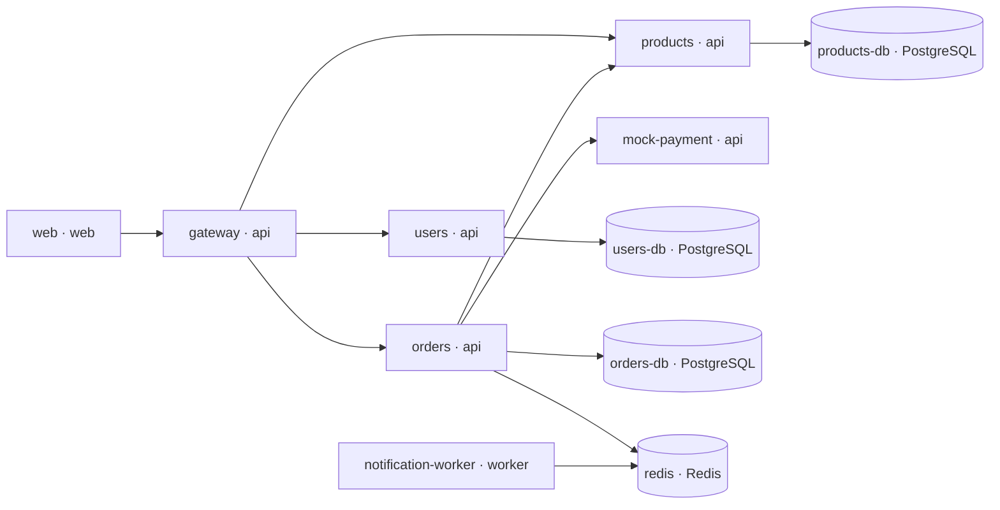

# 아키텍처

ReCoder 가 아키텍처 계약(`architecture.json`)에서 만든 문서입니다.



| 서비스 | 종류 | 언어 | 포트 | 공개 | 의존 | DB |
|---|---|---|---|---|---|---|
| web | web | node | 3000 | 예 | gateway | - |
| gateway | api | node | 8080 | 예 | users, products, orders | - |
| users | api | node | 3001 | - | - | users-db |
| products | api | node | 3002 | - | - | products-db |
| orders | api | node | 3003 | - | products, mock-payment | orders-db, redis |
| notification-worker | worker | node | - | - | - | redis |
| mock-payment | api | node | 3004 | - | - | - |

## 실행

```bash
cp .env.example .env   # 값을 바꾸세요
docker compose up -d --build --wait
node scripts/contract-test.mjs
```
